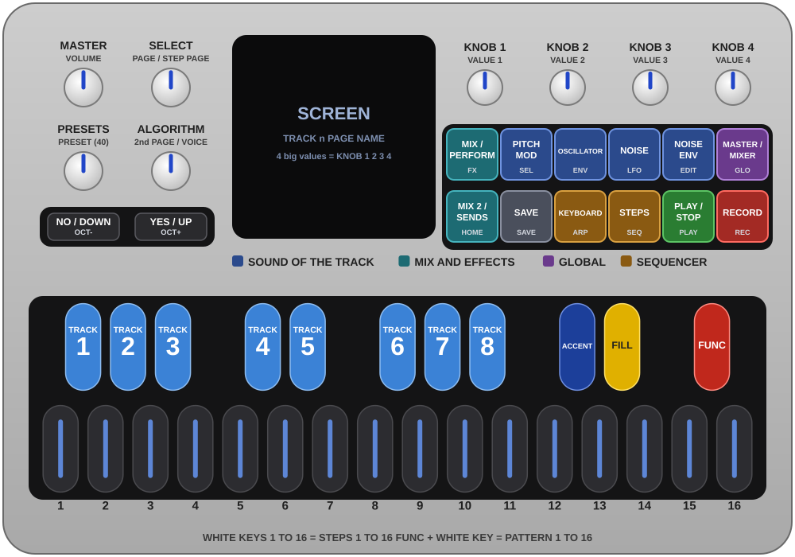

# FM1 TONIC

Nach dem Vorbild von Microtonic VST von Sonic Charge ist FM1 TONIC ein Drum-Synthesizer mit 8 Stimmen, in dem jeder Klang von Grund auf synthetisiert wird. Er verbindet eine tiefe Percussion-Engine mit einem Sequencer von 1 bis 64 steps (mit accents, fills und 16 Patterns pro Projekt), einem integrierten Mixer mit level und pan, Reverb, Delay und einem Master-Kompressor. Mit 40 project slots (8 Werks-Presets + 32 eigene Slots) und einem Workflow für den Live-Einsatz geht er mühelos von knackigen, rhythmischen Beats zu sich entwickelnden Ambient-Texturen.

## Merkmale

**Sound**

- Drum-Synthesizer mit 8 Stimmen: Jeder Track hat seinen eigenen oscillator, pitch mod, noise, mix, EQ und seine eigene Verzerrung.
- Level und pan pro Track sowie reverb send und delay send pro Track (im Enhanced-Engine zusätzlich low cut und high cut).
- Enhanced- oder Classic-Engine (Classic = nur die grundlegenden Klangeinstellungen, ohne die Extras des FM1 TONIC).
- Track-Randomizer: ein neuer Zufallssound für den gewählten Track.
- Choke groups (zum Beispiel geschlossene und offene Hi-Hat).
- Sidechain-Kompressor: Jeder Track kann die anderen ducken.

**Sequencer**

- Sequencer mit 64 steps, 16 Patterns pro Projekt. Feste Länge von 8, 16, 32 oder 64 steps oder freie Länge von 1 bis 64.
- Song mode.
- Globaler accent und accent pro Track, fill mit retrig (2x, 4x, 8x) und trig % (chance) auf jedem step.
- Parameter lock (begrenzt: 3 knobs pro Track in jedem Pattern).
- Record automation (begrenzt: 3 knobs pro Track).
- Live-Aufnahme, quantized oder unquantized. Swing, quantization und Tempo.
- Keyboard (ARP): Spiele einen Track wie ein Keyboard und nimm die Noten in die steps auf (ein Piano Roll).
- Kopieren und Einfügen eines Patterns, eines Tracks und eines Patterns on the fly, während der Song läuft.
- Mute und solo.
- Undo und redo.

**Mixen und Performen**

- Master-Mixer: level und pan jedes Tracks (der rote Punkt markiert die Mitte).
- Master-Kompressor.
- Performance-Seite: 2 Master-Effekte (reverb und delay), ein low cut und ALL FX OFF.
- Memory-Seite: wie voll der Projektspeicher ist.

**Projekte und Speichern**

- 40 project slots: 8 Werks-Presets und 32 eigene.
- Autosave und quick save.
- Projektname: GENERATE oder MANUAL. Projekt umbenennen.
- Backup und Wiederherstellung über die Webseite. Export und Import von `.mtpreset`-Presets.

**Display, Lichter und Einstellungen**

- 4/4-LED-Anzeige (weiße Tasten 1, 5, 9 und 13), Tastenlicht an oder aus.
- Zoom knobs (das große Rad, wenn ein knob gedreht wird), Farbthema.
- Ausgangslautstärke NORMAL oder LOUD. USB audio.

**MIDI**

- MIDI-Kanalwahl, notes out an oder aus, clock out an oder aus.
- Control changes (CC): 26 Sound-Parameter, pro gewähltem Track oder pro MIDI-Kanal.
- Remote-Panel: Spiele die eigenen Tasten des FM-1 von einem externen Keyboard oder einem Digitakt.

## 1. Das Panel

- **Knobs.** MASTER ist die Lautstärke. SELECT wechselt die Seite (in einer Liste: rauf und runter). PRESETS wählt eines der 40 Presets. KNOB 1 bis 4 stellen die vier Werte der Seite ein, die auf dem Display zu sehen ist (der gedrehte wird größer angezeigt). ALGORITHM wechselt zu einer zweiten Seite oder wählt eine Stimme, je nach Seite (die Seitentabellen sagen es). Ein kleines blaues Dreieck in einer unteren Ecke des Displays bedeutet, dass hinter ALGORITHM eine zweite Seite liegt: Dreieck rechts = ALGORITHM nach rechts drehen, Dreieck links = nach links drehen, um zurückzukehren.
- **Schwarze Tasten.** 1 bis 8 sind TRACK 1 bis 8, 9 ist ACCENT, 10 ist FILL, 11 ist FUNC.
- **Weiße Tasten 1 bis 16** sind die 16 steps des gewählten Tracks. Ein Pattern kann bis zu 64 steps haben, die jeweils 16 auf einmal angezeigt werden (siehe SEQ).
- **OCT- / OCT+** verschieben die Tonhöhe des gewählten Tracks eine Oktave nach unten oder oben (auf ARP: die Oktave des Keyboards). Bei einer Frage ist OCT+ = YES, OCT- = NO.

### Inhalt

1. Das Panel {#s1}
2. Signalweg {#s2}
3. Seiten, Button für Button {#s3}
4. Spielen {#s4}
5. Presets und Speichern {#s5}
6. Lichter, MIDI und USB {#s6}
7. Installieren, Backup, Wiederherstellen {#s7}
8. Die Engine {#s8}
  - Klangrezepte {#sound-recipes}
9. Credits {#s9}

---

> Die Kapitel 2 bis 9 sind auf Deutsch noch in Arbeit: Bis dahin erscheinen sie hier unten auf Englisch.

**So liest du die Seitentabellen.** Jeder Button hat eine Tabelle mit einer Zeile pro Seite. Normaler Text ist, was das Bedienelement allein tut. {r:Rot} ist, was es bei gehaltener **FUNC** tut, {o:orange} ist, was es bei gehaltener **FILL** tut (wie beim Digitakt).

**Was auf jeder Seite funktioniert** (die folgenden Tabellen wiederholen es nicht):

| Tasten | Was sie tun |
|---|---|
| Schwarze Taste 1 bis 8 | Wählt den Track und spielt ihn (auch während der Wiedergabe). |
| Weiße Taste 1 bis 16 | Die steps: einmal tippen = trig an, nochmal tippen = aus. Ein Pattern hat bis zu 64 steps, jeweils 16 angezeigt. |
| Weiße Taste gehalten + ACCENT / FILL | Dieser step bekommt einen accent / ein fill (nochmal = wieder entfernt). |
| {r:FUNC + schwarze Taste 1 bis 8} / {o:FILL + schwarze Taste 1 bis 8} | Track stumm (mute) / solo (nochmal = zurück). |
| {r:FUNC + weiße Taste} | Wechselt das Pattern (während der Wiedergabe: am Ende des Takts). |
| {r:FUNC + ACCENT} / {r:FUNC + FILL} / {r:FUNC + PLAY} | Pattern kopieren / einfügen (fragt PASTE PATTERN?) / löschen (fragt CLEAR PATTERN?). OCT+ = ja, OCT- = nein. |
| {r:FUNC + schwarze Taste 1 bis 8 gehalten, dann ACCENT / FILL / PLAY} | Den Sound dieses Tracks kopieren / einfügen / das Pattern dieses Tracks löschen (fragt nach). |
| {r:FUNC + SEQ} | Song mode an / aus (fragt nach). |
| {r:FUNC + ARP} | Löscht den Song (fragt nach). |
| {r:FUNC + SAVE} / {r:FUNC + HOME} | Quick save in den geladenen Platz / benennt das Projekt um. |
| {r:FUNC + REC} | QUANTIZED REC / UNQUANTIZED REC. |
| ENV + ein knob | Dieser knob springt auf seinen Standardwert zurück. |
| GLO + ACCENT / GLO + FILL | Undo / redo (auf jeder Seite). |
| REC + PLAY, dann Tasten und knobs | Live-Aufnahme: Die schwarzen Tasten 1 bis 8 schreiben trigs, die knobs schreiben Automation (3 knobs pro Track). |
| PLAY | Startet und stoppt das Pattern. |
| OCT- / OCT+ | Tonhöhe des Tracks eine Oktave tiefer / höher. Bei einer Frage: NO / YES. |

Ausnahmen: Auf PERFORM, MUTE / SOLO und der Pattern-Seite sind die schwarzen Tasten Mute-Buttons; auf ARP ist jede Taste eine Keyboard-Taste. Sie stehen alle in der nächsten Liste.

**Wo die Tasten etwas anderes tun.** Die Tasten des Panels (schwarze Tasten 1 bis 8 = Tracks, ACCENT, FILL, FUNC, weiße Tasten 1 bis 16 = steps) und die Kurzbefehle oben gelten auf allen Seiten dieses Handbuchs, außer auf den Seiten dieser Liste, wo die Tasten eine andere Aufgabe haben:

| Seite | Was die Tasten dort tun |
|---|---|
| **ARP** | Alle Tasten, weiße und schwarze, sind Keyboard-Tasten, die die gewählte Stimme spielen. |
| **PERFORM, MUTE / SOLO, PATTERN** (SEQ, 2. Druck) | Die schwarzen Tasten 1 bis 8 sind Mute-Buttons (im SOLO-Modus Solo-Buttons), sie wählen den Track nicht. Die weißen Tasten 1 bis 16 wählen das nächste Pattern. FUNC und FILL wechseln mit einem Tipp zwischen MUTE- und SOLO-Modus. |
| **DUCK** (SENDS, ALGORITHM nach rechts) | Die schwarzen Tasten 1 bis 8 wählen, welche Tracks geduckt werden. |
| **CHOKE** (EDIT, ALGORITHM nach rechts) | Die schwarzen Tasten 1 bis 8 wählen, welche Tracks in der choke group sind. |
| **SONG- und PATTERNS-Bildschirme** (Song mode) | Die weißen Tasten 1 bis 16 schreiben ein Pattern in den Takt. FILL löscht den Takt. |
| **Kopieren-Einfügen-Modus** (nach FUNC + ACCENT) | Die weißen Tasten 1 bis 16 sind die Plätze zum Einfügen. |
| **FUNC gehalten** | Die weißen Tasten 1 bis 16 sind die Patterns 1 bis 16; die Tasten leuchten dort, wo ein Pattern oder ein Track Noten hat. |

**Dinge, die es nur auf manchen Seiten gibt.**

| Seite | Tasten | Was es tut |
|---|---|---|
| Sound-Seiten: MIX 1, SEL, ENV, LFO, EDIT, VEL | Weiße Taste gehalten + knob 1 bis 4 | **P-lock**: Dieser step bekommt seinen eigenen Wert des knobs. Weiße Taste gehalten + SAVE + derselbe knob entfernt ihn. Ein Track speichert 3 p-lock-knobs pro Pattern. |
| Alle Seiten außer PERFORM, HOME, SONG, COMP und den Listen | Weiße Taste gehalten + SELECT | Die **chance** dieses steps: 5 bis 100 %, dann 1:2, 2:2, 1:3 ... 8:8. |
| ENV | OCT- / OCT+ | Die Frequenz des oscillators eine Oktave tiefer / höher. |
| EDIT | {r:FUNC + knob 2}, {r:FUNC, Tipp auf EDIT}, EDIT oder LFO gehalten + {r:FUNC + ACCENT / FILL / PLAY} | Tritt in die choke group ein / aus; DELETE AUTOMATION?; kopiert / fügt ein / setzt diese Track-Seite zurück. |
| SEQ | Knobs, SELECT, ALGORITHM, {o:FILL + SEQ} | Siehe die SEQ-Tabelle in Kapitel 3. |
| GLO > VEL | {r:FUNC + knob 4} | Ein neuer Zufallssound für den gewählten Track. |
| GLOBAL (HOME, 3. Druck) | Knob 4 (oder HOME gehalten + SELECT) | Das Tempo. |
