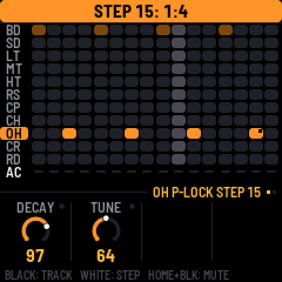
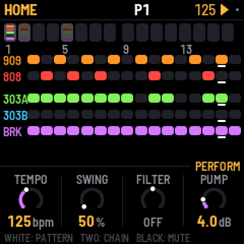
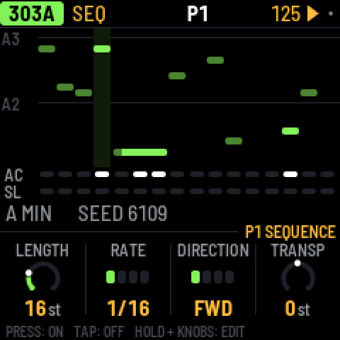
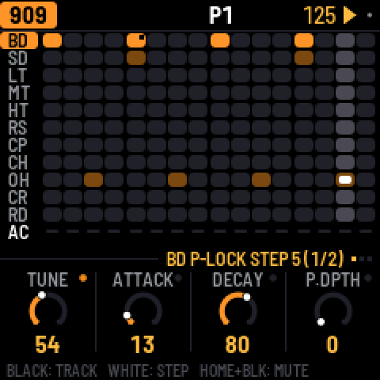
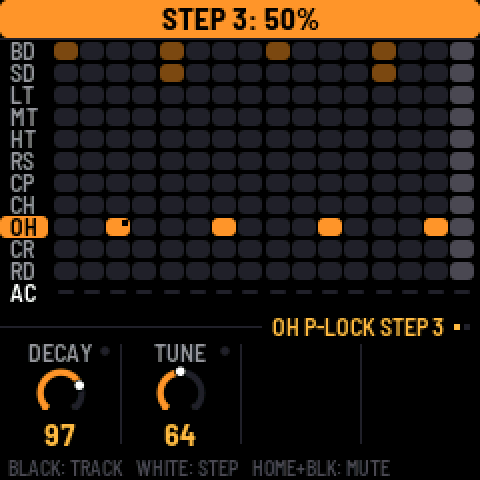
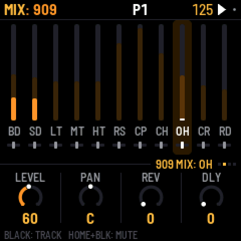
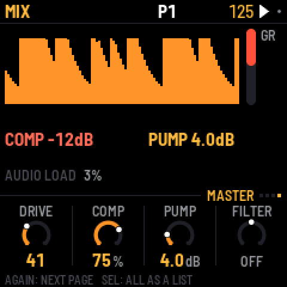
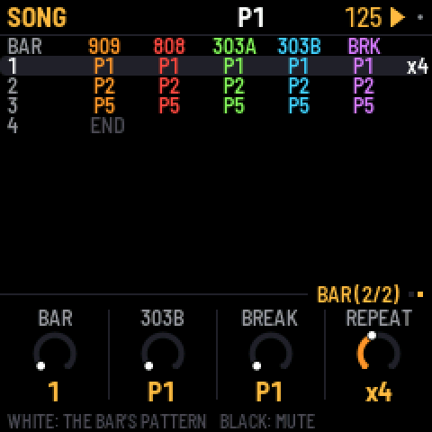

# What's new

The newest version first. Install it with the [web installer](../install/); the
[manual](../manual/) covers everything in detail.

## FM1 Tonic 1.7 · 18 November 2026

- CHANGED (wip507): manual 1.68, all six languages: Features and chapter 5 now say that presets work both ways (load `.mtpreset` from Patternarium and Microtonic, export yours back for the Microtonic VST; tested, the sound is very close, not identical). The web page (emulator) says it too and has an update pop-up for 1.7; the downloads moved down.
- CHANGED (wip489): **FM1 Tonic 1.7: the first build of the 1.7 line.** The instrument itself is the same as 1.6; what changed is the version number (the welcome screen, the package and the release say 1.7), the manual (1.57, it names firmware 1.7 in all six languages) and the project's card file for The FM-1 Firmware Hub, which now asks to be listed as a groovebox.

## FM1 Tonic wip307 · 13 November 2026

- CHANGED (wip474): **FM1 TONIC 1.6: zero samples.** The ER-99 cymbal samples (hi-hat, ride, crash) are gone from the firmware and the repository: they only fed the BREAK sampler's built-in loops, which no longer exist (the break part is not reachable from the panel and plays only loops of user sample slots, none by default). Deleted: assets/909, drum909.c/.h, the break-bank and sample generators and their tests; the drum lookup tables now come from tools/gen_drum_tables.py (same values, checked identical). The identity becomes FM-1_77010600. The manual (1.56) says every sound is synthesized with zero samples involved; fmhub.json has no 'sounds' line any more. Host tests give the same results as before. NOT built for the FM-1 yet (his PC does it).
- CHANGED (wip470): **manual 1.55:** the manual's first paragraph is new in all six languages (inspired by Microtonic VST by Sonic Charge, 8-voice drum synthesizer, every sound synthesized from scratch, sequencer, mixer, reverb, delay, master compressor, 40 project slots). The emulator page's first line is now: Inspired by Microtonic VST by Sonic Charge, FM1 TONIC is an 8-voice drum synthesizer.
- CHANGED (wip469): the emulator page's first paragraph now reads like the manual's first sentence, but shorter (8-track drum synthesizer inspired by Microtonic; the long 'not the same engine' explanation is left out there; the manual and the README keep it, with the Sonic Charge trademark note). Web text only: the firmware is the same 1.5.
- CHANGED (wip468): **FM1 TONIC 1.5: its own identity.** The package now reports **FM-1_77010500** (1.0-1.4 were FM-1_9XXYYZZ, the same numbering as X0X, so the hub could not tell the two apart). The web backup page and tools/x0x_backup.py accept both the new and the old identity, so a Tonic 1.0-1.4 still connects. The card picture on The Firmware Hub is the logo only (docs/card.png, 640 x 640), and its text says the synth is Microtonic-style. Nothing else in the firmware changed (the project format is the same). NOT TESTED yet: installing 1.5 over 1.4 on a real FM-1 (the update loader does not look at the identity, as far as the code shows).
- CHANGED (wip467): **manual 1.53:** the "Button combinations" tables (all keys, grouped by the button you hold first) are now translated in Spanish, Italian and French (they were English there). The screen messages stay in English, as the FM-1 shows them.
- NEW (wip466): **manual 1.52, chapter 7:** what the update screen shows when an update is refused (FAILED, the error number and reason, ERROR -5 HEAD DIFFERS and its details), a warning about custom bootloaders (put M-VAVE's stock bootloader back before returning to the official firmware), and a note on the newer FM-1 units with the B36014 flash chip. In English, Spanish, Italian and French. The wording FM1 TONIC is now in capitals in the manual.
- CHANGED (wip462): **FM1 Tonic 1.4: out of beta.** The instrument, the files and the installer all work, so the pages no longer say the firmware may be unstable (the sentence that the author accepts no responsibility stays). The web page's installer on the emulator page works again (it said "The installer is on the published page"). The firmware itself does not change.
- CHANGED (wip443): **FM1 Tonic 1.3: a refused return to the official firmware says what differs.** If the head check refuses an update (ERROR -5 HEAD DIFFERS), the screen now also shows the first differing byte, how many bytes differ and both head checksums, for 40 seconds. Nothing else changes.
- CHANGED (wip442): **FM1 Tonic 1.2: a failed update says why.** If an update to another firmware is refused, the update screen now shows FAILED, the error number with a short reason (for example ERROR -5 HEAD DIFFERS) and the step it stopped at, for 8 seconds. Nothing else changes.
- CHANGED (wip439): **FM1 Tonic 1.1: newer FM-1 units.** Some newer FM-1s have another flash chip (ID B36014 instead of 856014). 1.1 accepts both, so saving, presets, backup and restore work on them too (1.0 treated that chip as "no flash").
- CHANGED (wip437): **new factory settings:** clock out off, notes out off, Tonic MIDI channel 10, remote MIDI channel off, CC mode off, CC CH BASE 1-8, output LOUD, USB audio follows knob, 4/4 LED on, theme TONIC, zoom knob yes, AUTOSAVE off (press SAVE to keep your work; the settings are still kept by themselves), name projects GENERATE, Tonic Engine ENHANCED, 2nd core ON. A new unit or a factory reset gets them; a unit with a saved project keeps its own settings.
- CHANGED (wip434): **the project's address is now GitHub luigirossi-music/fm1-tonic:** the web page, installer, backup page, rescue script and manual links point there; the README is rewritten for 1.0; the screen reader's words link points to the new page. The credits to X0X and Felucca stay.
- NEW (wip433): **FM1 Tonic 1.0.** The welcome screen now says **VER. 1.0** (it said 0.9). The release is no longer called "beta": the package, the file name and the About line say 1.0.
- CHANGED (wip433): **trig chance (TRIG %) is big.** Hold a step and turn SELECT: the chance now fills the whole screen (TRIG %, the value, the step number), not the small text in the top bar that nobody saw. A 1:2 condition says TRIG CONDITION.
- CHANGED (wip431): **rename / letter editor (NAME PROJECTS = MANUAL):** the messages **PRESS SAVE** and **TURN KNOB 4** are bigger, and the right button says **OCT+ OK** (it said ACCEPT).
- NEW (wip430): **FUNC + PLAY (clear the pattern) now also works on the ARP page:** hold black key 11 (the FUNC key, a piano key on ARP) and press PLAY: the screen asks CLEAR PATTERN? (OCT+ = yes, OCT- = no). PLAY does not start or stop the music while that key is held.
- NEW (wip429): **ACCENT or FILL held: the trigs that carry that accent / fill BLINK** on the white keys (the other trigs stay lit), on the sequencer and the sound pages. Lights only: nothing else changes.
- CHANGED (wip428): **manual 1.34:** the copy-paste on the fly text now matches the firmware (big screen message PRESS PATTERN TO PASTE / PRESS SEQ TO EXIT, every pattern key blinks, an empty pattern dimmer, SEQ blinks, SEQ leaves the mode and opens the sequencer page); the contents list in the middle of the page is gone on screen (it is in the left column; print / PDF keep it); the **search is now under the contents** in the left column (on a phone it stays in the top bar). Firmware unchanged.
- CHANGED (wip427): **manual 1.33:** the brown-yellow colour is now the FM1 Tonic **blue** (links, buttons, search hits, contents).
- CHANGED (wip426): **web page:** a cleaner look, and the cheat sheet moved into a **Read more** in the Credits (it is still a PDF too). **libpo32** is credited by name again in the manual and on the page.
- CHANGED (wip425): **manual 1.31:** Patternarium is named again where the manual explains what a preset carries; PO-32 stays out.
- CHANGED (wip424): **manual 1.30:** the contents is now **always visible at the left** on a wide screen (the chapter you are reading is highlighted; on a phone it is still the drawer), the words **Microtonic and PO-32 are gone** from the manual (only the intro says it is inspired by Microtonic, and that FM1 Tonic has its own engine, not the same), and **engine** is no longer translated.
- CHANGED (wip423): **copy-paste mode: the instructions take the whole screen,** big, in blue: PRESS PATTERN TO PASTE and PRESS SEQ TO EXIT.
- CHANGED (wip422): **copy-paste mode (FUNC + ACCENT):** every pattern key blinks, an EMPTY pattern blinks less bright, and the **SEQ button blinks** too; the blue text says **PRESS PATTERN TO PASTE** and **PRESS SEQ TO EXIT**; pressing **SEQ** leaves the mode and opens the **sequencer page** (never the pattern page).
- NEW (wip420): **manual: a "Button combinations" section** (chapter 3): every combination of FUNC, FILL, ACCENT, GLO, HOME, ENV, SAVE and a held step, with what it does and on which pages it works. (The tables are in English in Spanish, Italian and French for now.)
- CHANGED (wip419): **manual:** undo / redo is GLO + ACCENT / GLO + FILL (all languages), and the pattern paste (FUNC + FILL) is described with its question PASTE PATTERN?.
- CHANGED (wip418): **ARP page: the current track blinks slowly.** All the keys are piano keys there, so the black key (1-8) of the selected track now blinks slowly to show which voice they play; ALGORITHM moves it.
- CHANGED (wip417): **undo and redo moved:** hold GLO and press ACCENT = UNDO, hold GLO and press FILL = REDO (on any page). HOME + REC and HOME + PLAY are no longer undo / redo: they are plain REC and PLAY again. The help cards of GLO, HOME, PLAY and REC say so.
- CHANGED (wip416): **pasting a pattern now asks first:** hold FUNC, press FILL and let go: the screen asks **PASTE PATTERN?** (OCT+ = yes, OCT- = no). It is only for the pattern: pasting a track or a page, pasting with a white key held, and the copy-paste mode work as before. Nothing is pasted if there is no copy yet.
- CHANGED (wip415): **copy-paste mode, many pastes:** after FUNC + ACCENT and a tap on FUNC (the mode stays on), pressing **FUNC + ACCENT again leaves the mode** (the screen says COPY MODE OFF, nothing is copied). The blue text now says WHITE KEYS PASTE - FUNC+ACCENT: EXIT. Before the tap, FUNC + ACCENT still copies again; a button still leaves the mode.
- NEW (wip414): **manual in French is complete: chapters 8 and 9 translated** (Le moteur with the 12 Recettes de sons, Crédits with the Luigi Rossi link). Only Portuguese and German chapters 2-9 still show in English.
- CHANGED (wip413): the **browser emulator no longer shows the welcome screen** (logo and version) after "Switch on": it goes straight to the screen. The FM-1 itself still shows it at power-on.
- NEW (wip412): **manual in French: chapters 6 and 7 translated** (Lumières, MIDI et USB with the CC table and the Digitakt / keyboard guides; Installer, sauvegarder, récupérer). Chapters 8 and 9 still show in English inside French.
- NEW (wip411): **manual in French: chapters 2 to 5 translated** (Chemin du signal, Les pages bouton par bouton, Jouer, Presets et sauvegarde). Chapters 6 to 9 still show in English inside French.
- NEW (wip410): **manual in Italian is complete: chapters 8 (Il motore, with all 12 sound recipes) and 9 (Crediti, with Luigi Rossi's Linktree)**. The 'in preparation' note is gone.
- NEW (wip409): **Luigi Rossi's Linktree (https://linktr.ee/luigirossi) is in the Credits of the web page and in chapter 9 of the manual** (all languages: English and Spanish have it translated, the others show the English chapter 9 for now).
- NEW (wip408): **manual, chapter 8: two more sound recipes (Crash, Clave)**, and the long intro paragraph of Sound Recipes cut to one sentence (English and Spanish).
- NEW (wip406): **manual, chapter 8: three more sound recipes** (Rimshot, Sub bass, Conga), page by page like the others (English and Spanish).
- CHANGED (wip404): **manual, chapter 8 recipes and curve table: the FX page MIX knob is written as the screen shows it** (OSC/NOISE MIX 100.00/00.00 = oscillator only, 49.61/50.39 = middle, 00.00/100.00 = noise only), not 0 to 127 (English and Spanish).
- CHANGED (wip389): **the emulator page's cheat sheet and the manual's shortcut tables now have two clear parts: what works on every page, and what works only on some pages** (FUNC red, FILL orange), then buttons press by press, presets and saving, lights. Old wrong lines fixed (PERFORM knobs, ARP voice = ALGORITHM, tempo on HOME's 3rd press, GLO settings = 5th press). Cheat sheet PDF and manual PDF rebuilt. Web page and docs only.
- CHANGED (wip388): **manual, chapter 8: the sound recipes are now page by page** (FX, SEL, ENV, LFO, EDIT, GLO, every knob with the value the screen shows) for kick, snare, closed hat, open hat, clap, tom and zap; each was rendered through the engine to check its length and shape. Manual only.
- CHANGED (wip387): **the manual has a new last chapter, 8. The engine**: the voice in one diagram, a knob-to-value curve table (frequency, decay, attack, Q), then every one of the 26 track settings in a table (where it lives, range, what it does: oscillator, pitch mod, noise filter and envelope, mix / EQ / distortion, velocity, level / pan / cuts / sends), the shared parts (choke, sidechain, master low cut, compressor, reverb, delay), enhanced vs classic, and starting points for kick, snare, hats, clap, tom, zap. Chapter 2 is now "Signal path" (the drawing and a short summary) and Credits is chapter 9. Corrected: with all three VELOCITY knobs at 0 an accent sounds the same as a normal step (the old text said it was louder). Manual only, no firmware change.
- NEW (wip386): **MIDI control changes (CC)**: GLO > CC MODE (OFF by default: SELECTED = CC on the Tonic's channel moves the selected track, CHANNELS = a block of 8 MIDI channels, one per track, BOTH) and GLO > CC CH BASE (first channel of the block). The CC number is the parameter (LEVEL 7, PAN 10, OSC 20-23, PITCH MOD 24-26, NOISE 27-31 and 102, MIX / DIST / EQ 103-106, VELOCITY 107-109, LOW / HIGH CUT 110-111, REVERB / DELAY SEND 112-113); the value goes through the same setter as a knob. The manual has the table and the Digitakt steps.
- NEW (wip385): **MIDI remote panel**: GLO > REMOTE MIDI CH (OFF by default) turns the notes F3 to G5 (53 to 79) of a second MIDI channel into the FM-1's own keys (note on = key down, note off = key up), so a MIDI keyboard, a Digitakt or a Digitone can press FUNC / ACCENT / FILL, the tracks and the steps; chords work in any note order. The manual has the note table and "Connect a Digitakt or Digitone" / "Connect a MIDI keyboard". Control changes on the Tonic's channel already reach the UI loop (wip384), no parameter is mapped yet.
- CHANGED (wip382): **manual rewritten shorter** (about 60 % fewer words): one panel drawing, a new ENGINE diagram (signal path), then one table per button (K1-K4 and what ALGORITHM, FUNC in red and FILL in orange do on each page). Install, back-up, rescue and the parameter list are now a short chapter; the old full text is in docs/reference/MANUAL_full_wip381.md.
- NEW (wip381): **manual: chapter 1A, BUTTONS AND PAGES, started with the FX button** (MIX 1, PERFORM, the MUTE / SOLO page, REVERB, REVERB 2, DELAY, DELAY 2): every knob, key and FUNC / FILL combination of each page, with a page card for each (the panel with the real screen of the page; black = by itself, red = with FUNC, orange = with FILL).
- CHANGED (wip380): **SONG screen: no zoom knob.** Turning K1 (bar), K2 (pattern) or K3 (repeat) no longer covers the screen with the big dial: the bar list stays visible and the turned cell is only highlighted.
- CHANGED (wip377): **copy-paste mode (FUNC + ACCENT):** one paste into a white key now makes that pattern the current one and ENDS the mode. To paste in many places, tap FUNC alone before choosing the destination: the mode stays on (blue text WHITE KEYS PASTE, SEQ: EXIT). FUNC held + white key is still the pattern change.
- NEW (wip379): **manual: the FM1 panel drawing with our own labels** (chapter 1: TRACK 1-8, ACCENT, FILL, FUNC, STEP 1-16, every button and knob) and **chapter 4.1 / 4.2: the sound engine page by page** (oscillator, pitch mod, noise, mix, velocity, level, pan, random) and what the ENHANCED engine adds to the 21 Microtonic settings.
- CHANGED (wip378): **HIT FLASH on every page except ARP:** it now also works on PERFORM, the pattern page (SEQ, 2nd press), DUCK, CHOKE, copy-paste mode, while FUNC is held and over questions.
- NEW (wip376): **HIT FLASH** (like the Digitakt): while the sequencer plays, a track's black key blinks for each of its hits. A key that is lit goes dark for the hit; a dim or dark key lights up.
- CHANGED (wip375): **PERFORM and the pattern page: white key lights:** an empty pattern = no light, a pattern with notes = low light, the CURRENT pattern = slow blink, the next (cued) one = blinks faster until it starts.
- CHANGED (wip374): **EDIT page footer** (first page): only the words CHOKE ALGORITHM, at the far right next to the blue triangle.
- CHANGED (wip373): **SENDS page footer** (HOME 2nd press): only the words SIDECHAIN ALGORITHM, at the far right next to the blue triangle.
- CHANGED (wip372): **leaving song mode** (FUNC + SEQ, OCT+; also after DELETE SONG) now really switches the song off (SONG OFF on the pattern page too) and lands on the **SEQ page** (first press), not on the old patterns page.
- NEW (wip371): **GLO mixer: blue hint at the bottom:** SELECT: CYCLE LVL/PAN, PAN CENTER = RED.
- CHANGED (wip370): **PERFORM footer:** the word ALGORITHM now sits right next to the blue triangle (it said ALGO: MUTE), so it is easy to see there is another page.
- CHANGED (wip369): **PERFORM and the pattern page (SEQ, 2nd press): the present pattern's white key is steady on, and the cued (next) pattern's key blinks** until it starts (the present one used to blink slowly).
- CHANGED (wip368): **PERFORM K3 is now a master LOW CUT** (20 Hz .. 663 Hz, the same smooth cut as each track's LOW CUT, on the whole mix only; the tracks' own low cuts are not touched). The old PERFORM filter is no longer on a knob (it is kept in the code and stays open). **Every help text at the bottom of a page is now blue.**
- NEW (wip367): **DELETE AUTOMATION.** Hold FUNC, tap EDIT and let it go: DELETE AUTOMATION? OCT+ deletes the selected track's p-locks and recorded knob motion in the playing pattern (OCT- keeps them). Page copy / paste / reset (FUNC + EDIT held, then ACCENT / FILL / PLAY) works as before.
- CHANGED (wip358): **empty places 09-40 start from different sounds.** An empty place used to load the sounds of preset 01; now it loads the sounds of the factory preset (place - 9) mod 8 + 1: 09 sounds like 01, 10 like 02, 11 like 03 ... 16 like 08, then 17 like 01 again, ... 40 like 08. Only the sounds (and tempo, swing, rate): no pattern, no song, nothing else.
- CHANGED (wip357, wip359): **the blue triangle fades slowly in and out** (every page that has a second page behind ALGORITHM: SENDS, EDIT, PERFORM, REVERB, DELAY and their second pages), so it is noticed without a flash. The footer stays as it was.
- CHANGED (wip365): copy-paste mode: the blue text is **PRESS WHITE KEY PASTE - SEQ: EXIT**, and a key **stops blinking once the copy is pasted there**.
- CHANGED (wip364): copy-paste mode: the playing pattern's key stops blinking (the others wait), the blue text says **PRESS WHITE KEY PASTE**; the SONG screen blue text says **FILL KEY DELETE** (it said POLY by mistake).
- NEW (wip362): **COPY-PASTE ON THE FLY.** FUNC + ACCENT copies the pattern and the white keys blink; a white key then pastes the copy there (no trig, no pattern triggered), even while playing, on any page. FUNC + ACCENT + a white key makes THAT pattern the copy (its key stays lit). Any button leaves the mode.
- CHANGED (wip362): the blue text at the bottom of the SONG screen now reads **WHITE KEYS 1-16 ADD ROW** and **POLY KEY DELETE**.
- CHANGED (wip361): **FILL on the SONG screen deletes the bar at once**: no DELETE BAR? question and no message any more.
- CHANGED (wip360): **deleting the last bar with FILL (OCT+ yes) deletes the whole song**: song mode is left and SONG is OFF, as with FUNC + ARP.
- FIXED (wip359): **DELETE SONG (FUNC + ARP) now also turns SONG OFF on the pattern page** (SEQ, second page, K1). It stayed on SONG ON before.
- CHANGED (wip357): on the SONG screen **FILL now asks DELETE BAR?** (OCT+ yes, OCT- no) before deleting, and the BAR tag at the right of the knob row is gone.
- CHANGED (wip356): **the SONG screen is one page.** K1 = the bar, K2 = its pattern, K3 = its repeat (it was on a second page that SELECT turned to; that page and the "BAR (1/2)" tag are gone). In blue at the bottom: KEYS 1-16: ADD, FILL: DELETE. FILL (pressed and let go, nothing else used) deletes the bar on the cursor; with the cursor on END it deletes the last bar. NEW: **FILL + SEQ** brings the SONG screen back from any page while you are in song mode (outside song mode it says NOT IN SONG MODE; on the ARP page FILL is a piano key, so it does not work there).
- NEW (wip353-354): **SIDECHAIN** (HOME, 2nd press = SENDS). K3 = SIDECHAIN INPUT (the track that ducks the others, 1-8, default 1, a big number), K4 = SIDECHAIN THRESHOLD (0-100 %, 0 = nothing ducks; it was called INTENSITY). ALGORITHM right on SENDS opens the DUCK screen: black keys 1-8 choose the ducked tracks (blue = ducked, grey = not, purple = the input). The duck follows the sound of the input track (a long note = a long duck), and the ducked tracks' reverb and delay sends are ducked too. A red dot marks a ducked track (it pulses with every duck; on SENDS it sits between the two sidechain knobs), a purple dot the input. Kept by the autosave and by SAVE. With the CLASSIC engine the sidechain is off (greyed). The depth is a first guess: it is tuned on the FM-1.
- CHANGED (wip344): **RANDOM never touches the volume or the pan** (before, it drew a new LEVEL between 80 and 110; now LEVEL stays exactly as it was; the pan was never touched).
- CHANGED (wip343): **SAVE: all 40 places can be overwritten.** On the slot screen (SAVE, OCT- NO, then OCT+ CHOOSE SLOT) the number now goes 1-40 and round (ALGORITHM right after 40 comes 1, left after 1 comes 40); places 1-8 are included (the new project is kept over the factory preset's number, the factory preset itself stays in the firmware). It starts at the NEXT EMPTY place after the one that is loaded (round); when every place is full it starts at the place after the loaded one.
- NEW (wip341): **blue triangle, bottom right,** on every page that has a second page behind ALGORITHM (PERFORM > MUTE / SOLO, REVERB > REVERB 2, DELAY > DELAY 2, EDIT > CHOKE): on the first page it is bottom right, pointing right (turn ALGORITHM right); on the second page it moves to the bottom LEFT, pointing left (turn ALGORITHM left to go back).
- FIXED (wip341): **the MUTE / SOLO page no longer disappears** a moment after ALGORITHM opens it. ALGORITHM now goes by direction (right = the 2nd page, left = back) instead of switching on every tick; the same for REVERB 2 and DELAY 2. Footer texts on PERFORM are a little shorter (ALGO: MUTE, ALGO: BACK).
- CHANGED (wip340): **the FUNC messages.** K2 turned alone on EDIT shows HOLD FUNC + TURN KNOB2: CHOKE and, smaller under it, TURN ALGORITHM TO SEE CHOKE GROUP. K4 turned alone on the GLO first page shows HOLD FUNC + TURN KNOB4: RANDOM.
- CHANGED (wip339): **HOME button.** It now cycles MIX PAGE 2, SENDS, GLOBAL PARAMETERS and then starts again. The PATTERNS and SONG screens that came after are gone from the HOME button (song mode is still FUNC + SEQ; FUNC + a white key still picks a pattern).
- FIXED (wip318): **LOW CUT and HIGH CUT (HOME first press) have no OFF any more.** The filters are always in the path (low cut from 20 Hz, high cut up to 20 kHz, nothing audible there), so turning the knob away from its end, or back to it, no longer makes a click.
- CHANGED (wip321): **the settings are always remembered.** A change in the GLO settings list (clock out, notes out, MIDI channel, output, USB audio, key light, theme, zoom, classic, cores, autosave itself) is now saved by itself even when AUTOSAVE is off: stopped, about 1.5 s after you stop touching, it says SETTINGS SAVED. Only the settings are written then; patterns and sounds still wait for SAVE.
- NEW (wip324): **NAME PROJECTS: GENERATE / MANUAL** (GLO settings list, in the PROJECT group under AUTOSAVE). GENERATE (default) is the name generator as before. MANUAL: when SAVE or FUNC + HOME asks for the name, you type it: the first letter A blinks, turn K4 to change it (capitals, digits, space, - . + # / % : ?), OCT+ accepts it and the next letter appears, OCT- deletes the last letter. From the first letter PRESS SAVE blinks: press SAVE to finish. 8 letters at most.
- NEW (wip326, FUNC added in wip327): **RANDOM SOUND** (GLO first press, the VEL page, K4: the blue RND icon). Hold FUNC and turn K4 (K4 alone only shows HOLD FUNC + TURN K4: RANDOM) and the selected track gets a completely new random sound; the icon blinks while it works. It changes only the 21 Microtonic parameters (so the sound can be saved as a Microtonic preset); the extras (pan, reverb and delay sends, low and high cut, effects, compressor) stay as they are. The volume (LEVEL) is never changed (wip344).
- CHANGED (wip330): the RANDOM button (GLO first press, K4) is a blue disc with RNDM written inside.
- CHANGED (wip337): the CHOKE button on EDIT (K2) now needs FUNC held: FUNC + K2 right = IN, left = OUT. K2 alone shows the big message HOLD FUNC + TURN K2: CHOKE (like RANDOM on the VEL page, FUNC + K4). RANDOM does not change the choke group.
- CHANGED (wip335): the CHOKE group is kept by the autosave too (it comes back after power-off, not only from a saved preset).
- CHANGED (wip334): GLO mixer: the lit box is behind the sliders (level pages) or behind the pan knobs (pan pages), no longer behind the track numbers; SELECT is round: 1 2 3 4 then 1 again (right), 4 3 2 1 then 4 (left).
- CHANGED (wip333): the CHOKE GROUP button has his new icon (two bars and a slanted stroke through a disc), black on blue (IN) / grey (NOT IN); RNDM on the RANDOM button is black. K2 on EDIT now sets the selected track IN (right) / OUT (left) at once; ALGORITHM right shows who is in the group (the CHOKE screen), ALGORITHM left goes back.
- CHANGED (wip329): MUTE, SOLO and CHOKE screens: one big number per pad; the CHOKE GROUP button on EDIT is a round icon, IN / NOT IN.
- NEW (wip328): **CHOKE GROUP** (EDIT, K2, top right). EDIT is now: K1 envelope mode (the blue icon, top left), K2 the CHOKE button, K3 attack, K4 decay. Turn K2 right: a screen like the MUTE / SOLO page opens; press the black keys of the tracks that belong to the group (blue = in, grey = not in). When one track of the group plays, it stops the others (3 ms fade). K2 left goes back. The group is saved with the preset.
- CHANGED (wip325): **RENAME screen.** FUNC + HOME now shows RENAME as a big title; the name under it is smaller. The normal SAVE name screen is unchanged.
- NEW (wip323): **Export my presets as .mtpreset** (the page, a new section above Restore my presets). Choose a slot (09-40) and press Export one, or press Export all to get one zip with a .mtpreset file for each saved slot (09_name.mtpreset ...). Open them in Microtonic or Patternarium. A .mtpreset has no place for what the Tonic added (ARP notes, late hits, per-track cuts and sends, compressor, reverb, delay, mutes), so those are left out; drum names become Drum n; the 8 patterns the FM-1 holds are written. The sounds, tempo and swing come across. Slots 1-8 (the factory presets) cannot be read from the FM-1.
- CHANGED (wip320): **imported preset names.** A name from a Microtonic .mtpreset is now cut to 8 letters, the same longest size as the made-up names of SAVE, so it shows as big as they do (a trailing ' (121)' tag goes first). Presets already imported keep their long names; import them again to get the short name.
- CHANGED (wip319): **SAVE HERE?** is easier to read: SAVE HERE? is big, the place number and the name are half size under it. Turning ALGORITHM on that screen picks another place (1-40) to save into: it shows the number, the project's name and who would be replaced (amber) or EMPTY PLACE; OCT+ YES saves there at once (the project's name), OCT- NO goes on to CHOOSE SLOT, where OCT- now says NO, EXIT.
- CHANGED (wip317): **the normal SAVE.** It first asks SAVE HERE? with the loaded place (number and name): OCT+ YES saves at once with the same name, OCT- NO goes to CHOOSE SLOT (OCT- EXIT SAVE, OCT+ CHOOSE SLOT), then the slot screen (ALGORITHM turns, OCT+ confirms, OCT- back) and the name screen (ALGORITHM new name, OCT+ saves, OCT- back). SAVE now works while playing: no more STOP FIRST. HOME leaves at every screen.
- NEW (wip317): **FUNC + HOME = RENAME PROJECT.** It opens the name screen alone (ALGORITHM makes another name, OCT+ saves, OCT- or HOME cancels). The project is saved into the place that is loaded now under the new name, places 01-08 included, and the place number stays. While playing it works too. Nothing loaded since power-on: it says NO SLOT YET: USE SAVE.
- FIXED (wip315): making a pattern longer (16 -> 32 -> 64) copies the ARP notes with the trigs, not only the trigs.
- NEW (wip314): FUNC + ARP asks DELETE SONG? (OCT- no, OCT+ yes). Yes deletes the song and leaves song mode.
- CHANGED (wip308): quick save (FUNC + SAVE) in an EMPTY place saves at once and names it UNTITLED 01, 02, 03 ... (the lowest free number); empty places are listed as EMPTY again (09 EMPTY, 10 EMPTY ...). The OVERWRITE SLOT? screen: the question mark is now in the same big font as the title, and the slot name is big and purple (small screen too). Needs the font to be generated again (see HANDOFF_308).

## FM1 Tonic wip306 · 13 November 2026

- CHANGED: the quick save question (FUNC + SAVE on a used place) now reads OVERWRITE SLOT? with OCT- EXIT (exit quick save) and OCT+ YES. It works while playing, as before.

## FM1 Tonic wip292 · 12 November 2026

- FUNC + REC switches between QUANTIZED REC (default) and UNQUANTIZED REC, and the screen says which. Quantized recording now puts a hit on the nearest step (it used to be the step playing, even just before the next one). UNQUANTIZED REC now keeps the exact timing: the hit stays on the step playing and is played late inside that step, as you pressed it (wip311; for now the timing is lost at power-off, saving it is the next piece).

## FM1 Tonic wip291 · 12 November 2026

- The FM-1 now introduces itself to the computer as "FM1 Tonic" (maker "FM1") instead of "X0X FM-1": that is the name of its USB MIDI and USB audio ports in your DAW and sound settings. Unplug and plug the USB cable again after the update; a computer may keep showing the old name until then.

## FM1 Tonic wip290 · 12 November 2026

- VEL (how hard velocity moves oscillator, noise and pitch mod) moved from EDIT's 2nd press to GLO's 1st press. GLO now goes VEL, mixer, COMP, MEMORY, settings, back to VEL. EDIT is only NOISE ENVELOPE.

## FM1 Tonic wip289 · 12 November 2026

- HOME, 1st press (MIX PAGE 2): K3 = low cut (20 Hz to 663 Hz), K4 = high cut (20 kHz down to 1 kHz, finest steps at the top), real 12 dB / octave filters like Ableton EQ Eight's Low Cut / High Cut 12 dB (before: gentle 18 dB shelves), per track, saved with the project and by SAVE.

## FM1 Tonic wip288 · 12 November 2026

- HOME, 2nd press: the track's Reverb Send (K1) and Delay Send (K2). MIX PAGE 2 keeps level and pan; GLOBAL is now the 3rd press.

## FM1 Tonic wip287 · 12 November 2026

- ARP page: K1 = FIXED LEN, K2 = the octave. ALGO now picks the voice (ARP and SEQ pages); SELECT keeps the SEQ page's job (step pages).
- SEQ page: ALGO goes through the 8 voices and then AC: with AC the white keys put trigs on the global accent.

## FM1 Tonic wip286 · 12 November 2026
- CHANGED: **quick save (FUNC + SAVE) works while the sequencer is playing**: no more STOP FIRST. An empty place goes to the name screens, a used place only asks OVERWRITE SLOT? (OCT- or HOME = no, nothing saved). The memory write can make the sound hiccup for a moment. The normal SAVE still wants the sequencer stopped.

## FM1 Tonic wip285 · 12 November 2026
- CHANGED: **the pattern page (SEQ, 2nd press) has the PERFORM mute / solo system**: black keys 1-8 mute / unmute, tap FUNC = every mute off, tap FILL = SOLO mode (many solos) or every solo off, the mode key and the muted / soloed keys light and blink as on PERFORM, the white keys pick the next pattern and the current pattern blinks. On this page FUNC and FILL are no longer modifiers: copy, paste, clear, song mode and quick save are done from the other pages.

## FM1 Tonic wip284 · 12 November 2026
- CHANGED: the **GLO mixer's volume animation** (the hit lighting the slider up to its level) is white again, not purple.
- NEW: **FUNC clears every mute** on both PERFORM pages, the same way FILL clears every solo: mute as many tracks as you like with the black keys 1-8, then tap FUNC and they all play again.

## FM1 Tonic wip271 · 11 November 2026
- NEW: **MUTE / SOLO page.** On PERFORM press FX again: the MUTE / SOLO page (FX once more goes to MIX). It opens in MUTE mode (FUNC lit): black keys 1-8 mute / unmute the tracks. Tap FILL for SOLO mode (FILL lit): a black key solos that track (another key moves the solo, the same key again ends it). Keep FILL pressed while you tap keys to solo several tracks together. Tap FUNC to go back to MUTE mode.

## FM1 Tonic wip270 · 11 November 2026
- NEW: **Second pages for REVERB and DELAY.** On the REVERB / DELAY pages (hold FX / hold HOME) turn ALGORITHM to go to REVERB 2 (low cut, return) or DELAY 2 (low cut, return, ping-pong), and again to come back.

## FM1 Tonic wip269 · 11 November 2026
- CHANGED: **REVERB and DELAY pages** (hold FX / hold HOME) no longer show the send bars for TNC / 808 / BRK at the top: the page's name is shown there, big.

## FM1 Tonic wip268 · 11 November 2026
- CHANGED: **MEMORY page** is centred on the screen and uses the Tonic purple (not red) from 90%.

## FM1 Tonic wip267 · 11 November 2026
- NEW: **MEMORY page.** GLO, third press (MIXER, COMP, MEMORY, then the settings): an upright battery of blue liquid shows how full the project memory is, with the percentage; purple from 90%, FULL at 100%. The settings list is now the fourth press.

## FM1 Tonic wip266 · 11 November 2026
- CHANGED: **FUNC + SAVE screens** now show [HOME] EXIT under the buttons (HOME already left without saving). The OCT- / OCT+ buttons are unchanged.

## FM1 Tonic wip265 · 11 November 2026
- CHANGED: **FUNC + SAVE.** In an empty place it opens the SAVE AS name screens (no slot screen: the slot is the loaded one); in a place that holds something it asks OVERWRITE SLOT? (OCT- NO, OCT+ YES) and YES saves at once with the same name.

## FM1 Tonic wip264 · 11 November 2026
- NEW: **SOLO.** Hold FILL and press a track's black key 1-8: only that track plays and its key blinks. FILL + another key moves the solo; pressing the soloed track's key ends it. Your mutes are untouched, the solo is not saved and a preset load ends it.

## FM1 Tonic wip263 · 11 November 2026
- NEW: **FUNC + SAVE = quick save.** It saves your project at once into the preset place that is loaded now (same number, same name), with no question. Playing: it says STOP FIRST and saves nothing. Nothing loaded since power-on: it says NO SLOT YET: USE SAVE. An empty place gets a made-up name. Places 01-08 are saved over themselves. Like SAVE AS, it keeps the compressor, reverb and delay in the preset.

## FM1 Tonic wip262 · 11 November 2026
- No code change (a plan only): the GRIGIOTONIC theme (a grey background like the welcome logo, for all pages) is written down in HANDOFF_262 for later jobs.

## FM1 Tonic wip261 · 11 November 2026
- Welcome screen: BY LUIGI ROSSI a little bigger again and a little higher.

## FM1 Tonic wip260 · 11 November 2026
- Welcome screen: the whole FM1 TONIC logo (box, name, knobs, steps) is 20 % smaller, the same look as before (wip259's font change is undone). BY LUIGI ROSSI is a little bigger, in the same font.

## FM1 Tonic wip259 · 11 November 2026
- Welcome screen: the FM1 TONIC name is a little smaller and BY LUIGI ROSSI a little bigger.

## FM1 Tonic wip258 · 11 November 2026
- No code change (a plan only): the MEMORY page on GLO (a battery full of blue liquid) is written down in HANDOFF_258 for a later job.

## FM1 Tonic wip257 · 11 November 2026
- FM-1 build: the pool headroom check (8 KB free) failed after wip256 (4064 B free). The undo history memory is 5 KB smaller (15 KB instead of 20 KB): fewer or shorter undo steps are kept when you edit a lot. No other change.

## FM1 Tonic wip256 · 11 November 2026
- RAM fix for the FM-1 build (wip255 did not link: .bss 6864 bytes too big). The ARP notes are no longer in the undo copy (undo does not undo notes), and two buffers (the preset viewer and the packer table) moved from .bss to the pool. No other change.

## FM1 Tonic wip255 · 10 November 2026

- DONE (wip255) OPTION B, step B1 of 4 (storage only): the flash now has room for 8 more preset slots, which will replace presets 1-8 once you save over them. If one of them holds a preset, the PRESETS knob loads it instead of the factory preset of that number; empty, the factory preset plays as before. You can not save into them yet (step B2: SAVE AS will choose 1-40), and the USB backup does not cover them yet (step B3). Presets you saved in slots 9-40 are untouched. A preset written over a factory one stays: there is no way back to the factory preset (your choice).

## FM1 Tonic wip254 · 10 November 2026

- DONE (wip254) ARP, step 3 of 3: the sequencer now plays every step at its recorded note: the voice's own sound, its pitch moved by the stored semitones (FILL retriggers too). A step with no note plays at the voice's own pitch, as before. The ARP page is complete: ARP, play the keys, REC + PLAY records them, PLAY plays them back. MIDI out is not changed (drum notes stay as they were).

## FM1 Tonic wip253 · 10 November 2026

- DONE (wip253) ARP, step 2b of 3: on the ARP page, with REC on and the pattern playing, every key you press is recorded: a trig on the playing step of the selected voice (SELECT) and the note (semitones from the voice's own pitch, moved by the keyboard octave). The screen says NOTE +7 (or -5 ...) for a moment; there is no LED for it. Stopped, or REC off, a key only sounds. Only patterns 1-16 keep notes. The sequencer does not play the notes yet (step 3): a recorded step still plays at the voice's own pitch for now.

## FM1 Tonic wip252 · 10 November 2026

- DONE (wip252) ARP, step 2a of 3: the project now has room for a note (semitones, -64..+63, 0 = the voice's own pitch) per Tonic track per step, in patterns 1-16. Nothing records or plays them yet (2b: REC + PLAY on the ARP keys; 3: the sequencer plays each hit at its note). The notes go with the trigs: a trig tapped off, CLEAR TRACK, CLEAR PATTERN clear them; copy / paste of a pattern copies them; undo takes any of it back (it says NOTES). They are saved with the project, and a project saved by an older firmware still loads (with no notes).

## FM1 Tonic wip251 · 10 November 2026

- DONE (wip251) ARP PAGE, step 1 of 3: the ARP button now opens a page that looks like SEQ (the steps, the playhead, PLAY / REC / HOME and all the other buttons as on SEQ) but every key, white and black, is a piano key for the selected voice. SELECT chooses the voice (round, 1-8); OCT- / OCT+ move the keyboard by octaves (-3 to +3, shown on the bottom screen: only OCTAVE, no other parameters). The 27 keys run in semitones from F; the C key (the 8th key from the left, and the C an octave higher) plays the voice's own pitch, the others are higher or lower by the number of semitones. The voice's stored pitch never changes: the key only moves the pitch for that one hit. Nothing is recorded or stored yet (steps 2 and 3: a note per step, recorded with REC + PLAY, played back by the sequencer). SEQ goes back to the SEQ page; FUNC, ACCENT and FILL are notes on this page too.

## FM1 Tonic wip246 · 10 November 2026

- DONE (wip246) CHEAT SHEET, MANUAL, CREDITS: the cheat sheet on the page was checked against the manual and the code and rewritten: it now covers chance (SELECT on a held step), p-lock removal and the 3-knob limit, redo, tempo, the SEQ step pages, presets and SAVE, what comes back at power-on, the tracks' sends, ALL FX and the 4/4 LED. Both the cheat sheet and the user manual can be downloaded as PDF (links in the page header and in the Cheat sheet and Credits sections; the files are made by tools/make_pdfs.py). The manual now lists the two sends (24 values per track). New Credits: FM1 Tonic is made by Luigi Rossi, with the projects, authors and licences it is built on (manual chapter 16 and a Credits section on the page).

## FM1 Tonic wip245 · 10 November 2026

- DONE (wip245) WEBAPP LOOK: the install block is now "Install FM1 Tonic Latest Version". **Install** and **Back Up my Presets** sit side by side under a warning that the update deletes presets. Pressing Install asks "Are you sure?" first, with Back Up my Presets, Install anyway and Cancel. The Screen reader section and the Your breaks section (slots to upload loops) are gone from the page. The install, receive, back up and restore blocks are cards. NOT tried with a real FM-1.

## FM1 Tonic wip244 · 10 November 2026

- Restore my presets: every preset in the list now has its own slot menu (first empty, or 1-40), so you choose where each .mtpreset goes. Slots 1-8 (the factory presets) are shown but cannot be chosen yet.

## FM1 Tonic wip243 · 10 November 2026

- Restore my presets (the page) now also takes Microtonic .mtpreset files: choose one or many, or a whole folder, or a zip that holds them. The page converts them itself, the same way as the tool that made the factory presets, and lists what goes where. A file named 09_name.mtpreset (a number 9-40 first) goes into that slot; the others take the first empty slots of the FM-1. A Microtonic preset keeps its 8 sounds, tempo, swing and its first 8 patterns (the page says when patterns are left out).

## FM1 Tonic wip242 · 9 November 2026

- Every track has its own reverb send and delay send: HOME (first press, MIX PAGE 2) now has K1 level, K2 pan, K3 reverb send, K4 delay send. They work whatever the PERFORM dry / wet is and also with ALL FX off (ALL FX off mutes only the PERFORM reverb, delay and filter). They are saved with the preset and the project.

## FM1 Tonic wip241 · 9 November 2026

- SEQ page, AUTOSCROLL off: SELECT turns only through the step pages the pattern length has (16 steps: no page change; 32: two pages; 48: three; 64: four).

## FM1 Tonic wip240 · 9 November 2026

- SEQ page: with AUTOSCROLL off, the SELECT knob now cycles the white keys through steps 1-16, 17-32, 33-48 and 49-64 (and round). With AUTOSCROLL on, SELECT does nothing there, as before.

## FM1 Tonic wip239 · 9 November 2026

- The welcome screen (the logo) stays half a second longer (about 1.7 s), and the version screen after it now reads "VER. 0.9" instead of "V0.9".

## FM1 Tonic wip238 · 9 November 2026

- The limit of locked knobs per track in a pattern is now 3 (it was 5 in wip237): a 4th knob shows "MAX 3 PER TRACK". Knobs that already have a lock keep working on every step.

## FM1 Tonic wip237 · 9 November 2026

- A track now keeps at most 5 locked knobs (p-lock lanes, also knobs recorded live) in a pattern, so the machine is never asked to follow too many parameter changes. A 6th knob shows "MAX 5 PER TRACK"; knobs that already have a lock keep working on every step. Projects saved with more than 5 are left as they are.

## FM1 Tonic wip236 · 9 November 2026

- Live recording (REC + PLAY) now works on every page but PERFORM: before, the black keys only played the sound on the ENV, LFO, EDIT, SEL, FX (MIX), GLO mixer and MIX PAGE 2 pages and did nothing on REVERB, DELAY, PATTERNS and SONG; now they also write a trig at the playing step there. The pattern page (SEQ, 2nd press) keeps its black keys as mute buttons, like PERFORM.

## FM1 Tonic wip235 · 9 November 2026

- At every power-on the PERFORM page now starts clean: reverb dry / wet 0 %, delay dry / wet 0 %, filter OFF, ALL FX on. Before, values saved with SAVE came back after a restart (for example reverb 57 %, delay 6 %). Loading a preset still brings back the effects you saved in it; the compressor still comes back as saved.

## FM1 Tonic wip234 · 9 November 2026

- GLO > 4/4 LED (under LIGHTS in KEYS AND SCREEN) is now OFF by default: no beat lights on white keys 1, 5, 9 and 13 until you switch it ON. Settings saved before this version that never held the setting also start OFF; if you already saved it ON it stays ON.

## FM1 Tonic wip233 · 9 November 2026

- The beat lights on white keys 1, 5, 9 and 13 are now at the lowest level that still shows: just slightly on, so they never get mixed up with the trigs you enter.
- New setting in GLO, under LIGHTS in KEYS AND SCREEN: 4/4 LED ON / OFF (default ON). OFF turns the beat lights off on every page. It is saved with the project.

## FM1 Tonic wip232 · 9 November 2026

- The beat lights on white keys 1, 5, 9 and 13 are now fainter than before: they have their own, lower brightness level (half of the old dim level), so they cannot be mistaken for steps or patterns.

## FM1 Tonic wip231 · 9 November 2026

- White keys 1, 5, 9 and 13 now glow dimly on every page except PERFORM, to mark the four beats of the bar. A lit key (a step that is on, the playhead) stays brighter.

## FM1 Tonic wip230 · 9 November 2026

- A muted track's black key blinks slowly again (it had become fast).

## FM1 Tonic wip229 · 9 November 2026

- The GLO mixer (the 8 sliders) now shows the name of the project (preset) you are on in the top-left chip, instead of the selected track's name: it is the master mix, not a track. Before any preset is loaded after power-on it says MASTER.

## FM1 Tonic wip228 · 9 November 2026

- SAVE now keeps the compressor, the reverb and the delay inside the preset: load it again, or switch on, and they are as you saved them. A preset without them (the factory ones) starts with the compressor at threshold 0.0 dB, make-up 0.0 dB and the reverb and delay off.
- The autosave still does not keep the compressor, the reverb and the delay: only SAVE does.

## FM1 Tonic wip227 · 9 November 2026

- The compressor, the reverb and the delay are kept only when you press SAVE; the autosave no longer keeps them. The first start of this version resets an older saved compressor setting to 0.0 dB.

## FM1 Tonic wip224 · 9 November 2026

- The mixer (GLO) has longer sliders over the whole screen and no knob row below; the settings list no longer shows the compressor knobs.

## FM1 Tonic wip223 · 9 November 2026

- FX now cycles only MIX and PERFORM. Hold FX for half a second to see the REVERB parameters, hold HOME for the DELAY parameters. FX and HOME no longer show a help card when held.

## FM1 Tonic wip221 · 9 November 2026

- The PATTERNS screen shows the hint FUNC + KEY: LAST OFF once you have added a pattern.

## FM1 Tonic wip220 · 9 November 2026

- The step grid is taller (bigger steps) and its track numbers are bigger.

## FM1 Tonic wip219 · 9 November 2026

- The step grid colours: trig white, accent dark blue, fill yellow, accent and fill together green (the whole step).

## FM1 Tonic wip218 · 9 November 2026

- On the PATTERNS screen (building a song), FUNC + any white key takes the last pattern off the song again; keep pressing to take more off.

## FM1 Tonic wip215 · 9 November 2026

- The welcome screen now says BY LUIGI ROSSI (capitals, bigger) under the logo, and the version shows big on its own for half a second after it.

## FM1 Tonic wip214 · 9 November 2026

- The step grid shows the flags more clearly: accent = top half deep blue, fill = bottom half pale cyan, both = the whole step dark purple.

## FM1 Tonic wip213 · 9 November 2026

- The screen where you add patterns to the song is now titled PATTERNS.

## FM1 Tonic wip212 · 9 November 2026

- Song mode is now FUNC + SEQ: press it to enter (OCT+ confirms) and again to leave. FUNC + HOME and FUNC + OCT+ no longer do anything.
- The CHAIN screen is now called PATTERNS, and it opens when you enter song mode with an empty song.
- On the pattern page (SEQ, second press) K1 now says SONG ON / SONG OFF. In song mode, SONG OFF pauses the bars and the current bar loops; SONG ON lets them go on.

## FM1 Tonic wip206 · 9 November 2026

- New FUNC keys: FUNC + ACCENT copies (the pattern, a track's sound, or a page), FUNC + FILL pastes (hold FILL and press a white key to paste into that slot), FUNC + PLAY clears. FUNC + SEQ and FUNC + REC no longer do copy or clear, and FUNC + ACCENT / FILL no longer clear accents and fills.

## FM1 Tonic wip205 · 9 November 2026

- The SAVE AS screens (name, name editing, slot) and the CHAIN screen now take the whole screen, with bigger text, like the other messages.

## FM1 Tonic wip204 · 9 November 2026

- Probability (hold a step + SELECT) now also works on the mixer and on the effects pages after PERFORM (REVERB, DELAY and the others). White keys hold a step there; with no step held SELECT works as before. PERFORM, HOME, SONG, GLOBAL, COMP and the lists are unchanged.

## FM1 Tonic wip203 · 9 November 2026

- P-locks: while you hold a step and turn a knob, the icons (waveform, filter mode, envelope mode, pitch-mod shape) and the value text now show that step's locked value, not the knob's own. Let go and they show the knob again.

## FM1 Tonic wip202 · 9 November 2026

- While you record with the sequencer playing, the REC button now blinks together with PLAY. Armed with the sequencer stopped, REC stays lit.

## FM1 Tonic wip200 · 8 November 2026

- The FX button remembers where you left it: if you were on the PERFORM (or REVERB, DELAY…) page, went to another page, and press FX again, you come back to that effects page, not to the MIX page. Pressing FX again on the last effects page still goes round to MIX.

## FM1 Tonic wip199 · 8 November 2026

- Warnings and questions now take the whole screen: when something does not happen (for example MOTION FULL, NOTHING COPIED YET, PRESET EMPTY) and when the unit asks you something (CHANGE PRESET?, clear, delete…), you see only the message, with a purple frame, and no buttons legend or knobs. Short confirmations still show at the top, as before. The warning stays a little longer (1.8 s).

## FM1 Tonic wip198 · 8 November 2026

- Preset screen: when you turn the PRESETS knob, the preset's number and name are now big and purple (the question "CHANGE PRESET?" is small above them). Very long names shrink to fit.

## FM1 Tonic wip197 · 8 November 2026

- Fixes probability: holding a step and turning SELECT sets the step's chance on the ENV, LFO, EDIT, SEL and FX pages again (it only worked on SEQ).

## FM1 Tonic wip195 · 8 November 2026

- Fixes p-locks: holding a step and turning a knob on the ENV, LFO, EDIT, SEL or FX pages gives that step its own value again (it had stopped working). To remove a lock, hold the step, hold SAVE and turn the knob.

## FM1 Tonic wip190 · 8 November 2026

- Fixes the firmware build: its register-access check also scanned the Bluetooth radio headers (not used by the firmware yet) and refused to build. No change in what the FM-1 does.

## FM1 Tonic wip189 · 8 November 2026

- Fixes the firmware build: the app's main memory overflowed by 2.4 KB after the preset backup code was added, so two performance-test buffers moved to the spare memory area. No change in what the FM-1 does.

## FM1 Tonic wip188 · 8 November 2026

- The name X0X is gone from everything you read: the README, the manual, this list, the web pages (install, back up, break loops) and the two places the FM-1 shows its name (the editor and the name it gives a computer). One credit line ("built on X0X and Felucca") stays, as the licence asks. File and code names are next.

## FM1 Tonic wip187 · 8 November 2026

- Fixes a firmware build error in wip186 (a name used twice in the preset backup code). No change in what the FM-1 does.

## FM1 Tonic wip186 · 8 November 2026

- The browser page has "Restore my presets": choose the zip from Back up my presets (or one .tnp file), check the list of slots, confirm, and the page writes them into your FM-1 (Chrome or Edge, USB, FM-1 stopped, wip185 firmware). "Clear all slots" empties slots 9-40 to start with a white canvas, but only after a backup zip was downloaded on that page. Not yet tried with a real FM-1.

## FM1 Tonic wip185 · 8 November 2026

- Behind the scenes, for the coming "Restore presets" button: the FM-1 can now receive one preset over USB into a slot of your choice (9-40) and clear one slot. It checks the preset first and says PRESET SAVED FROM USB; it refuses while the sequencer plays. Nothing changes in how you play. Not yet run on a real FM-1.

## FM1 Tonic wip184 · 8 November 2026

- The browser page has a "Back up my presets" button (Chrome or Edge, FM-1 connected by USB, needs the wip183 firmware on the FM-1): it downloads one zip with every preset you saved in slots 9-40, one .tnp file per slot (09_name.tnp, 10_name.tnp, ...). Nothing on the FM-1 changes. Restoring from the zip comes next. Not yet tried with a real FM-1.

## FM1 Tonic wip183 · 8 November 2026

- Behind the scenes, for the coming "Back up my presets" button: the FM-1 can now tell the computer over USB which of your slots 9-40 hold a preset, and send one slot's preset. Nothing changes on the FM-1's screen or in how you play. Not yet run on a real FM-1.

## FM1 Tonic wip182 · 7 November 2026

- SAVE AS into your own slots 9-40 is switched on in the firmware. To make room, the 3 user break-loop slots are gone from the FM-1 (the built-in breaks stay). If you uploaded your own loops before, they are no longer played, and the first preset you save overwrites their memory. Not yet run on a real FM-1.

## FM1 Tonic wip181 · 7 November 2026

- The browser page can receive the project from your FM-1 over USB ("Receive the project from your FM-1", Chrome or Edge): the 8 voices' sounds, patterns, song and knob motion. Switch on to play it in the browser, and download its 8 voices as WAV files. It replaces the project kept in the browser; break loops are not included.

## FM1 Tonic wip180 · 7 November 2026

- The browser page has a "Download the 8 voices" button: one zip with one hit of each of the 8 voices of the sound playing now, as 16-bit stereo WAV files (44.1 kHz). Each hit is dry (the voice's own EQ, drive, level and pan; no FX or master) and does not disturb what is playing.

## FM1 Tonic wip179 · 7 November 2026

- The cheat sheet on the browser page lists each button (EDIT, ENV, LFO, SEL, FX, GLO, HOME, SEQ) on its own line.

## FM1 Tonic wip178 · 7 November 2026

- The browser page has a new section, "Put FM1 Tonic on your FM-1": connect the FM-1 by USB, press Install, and the firmware is written from the page (Chrome or Edge). It works on the published page, not in a local copy.

## FM1 Tonic wip175 · 7 November 2026

- The big knob on the screen now looks like the logo knob: a light round cap with a blue pointer. The ring of lights around it works as before.

## FM1 Tonic wip174 · 7 November 2026

- The browser emulator's knobs look like the logo knobs: light round knobs with a blue pointer, no dark ring.

## FM1 Tonic wip173 · 7 November 2026

- The browser emulator's FM-1 body is now the grey of the FM1 TONIC logo, with a dark border and dark knob labels.
- The emulator's cheat sheet is brought up to date: FX cycles MIX, PERFORM, REVERB, DELAY; the compressor is on GLO (mixer, compressor, settings); the black keys always sound.

## FM1 Tonic wip172 · 7 November 2026

- The browser emulator's panel buttons (FX, SEL, ENV ... OCT-, OCT+) now look like the logo: little grey boxes with a dark label; a pressed button lights blue.

## FM1 Tonic wip171 · 7 November 2026

- The browser emulator page now has a dark background, like the ground of the FM1 TONIC logo, with light text; the boxes stay light.

## FM1 Tonic wip170 · 7 November 2026

- The browser emulator's break slot boxes and the cheat-sheet cards are rounded like the FM1 TONIC logo box, with a dark border.

## FM1 Tonic wip169 · 7 November 2026

- The browser emulator's small buttons (Mute, Factory reset, Read the whole screen, Say it again, Choose files, Clear) now look like the logo box too.

## FM1 Tonic wip168 · 7 November 2026

- The browser emulator's "Switch on" button now looks like the FM1 TONIC logo: a rounded grey box with a dark border.

## FM1 Tonic wip167 · 7 November 2026

- The browser emulator page: the section headings (Screen reader, Your breaks, Keyboard, Cheat sheet ...) now have a short blue bar, the blue of the FM1 TONIC logo.

## FM1 Tonic wip166 · 7 November 2026

- The browser emulator now shows the welcome screen (the FM1 TONIC logo and the version) for about a second after you press "Switch on", as the FM-1 does at power-on.

## FM1 Tonic wip165 · 7 November 2026

- The browser emulator title now looks like the logo: a small grey box with FM1 in blue and TONIC in dark grey.

## FM1 Tonic wip161 · 7 November 2026

- New welcome screen: at power-on the FM-1 shows the FM1 TONIC logo (a small grey drum machine) and the version for about a second.

## FM1 Tonic wip152 · 6 November 2026

- Fix: SAVE AS now keeps patterns 1-8 (and which of them are chained), not only pattern 1. Presets you saved before this update still hold just their first pattern.

## FM1 Tonic wip128 · 5 November 2026

- The manual is rewritten for the Tonic (no more 909, 808, 303 or break chapters).

## FM1 Tonic wip127 · 5 November 2026

- The Tonic is now called TONIC on every screen (it used to say 909): the part, its MIDI channel row, the mixer page, the pump source.

## FM1 Tonic wip126 · 5 November 2026

- GLO settings: the KEY SOUND row is gone (the black keys always sound, also while playing).

## FM1 Tonic wip124 · 5 November 2026

- GLO button, first press: the 8-track mixer. Eight vertical sliders, one per track; SELECT switches between tracks 1-4 and 5-8, K1-K4 are the levels of the four tracks shown (the black keys pick a track too), and a hit lights the slider up. Press GLO again for the settings list, once more to come back to the mixer.

## FM1 Tonic wip123 · 5 November 2026

- SEQ button: FIXED LEN now has 8 / 16 / 32 / 64 steps (16 stays the default). Going from 8 to 16 copies steps 1-8 into 9-16, like the other doublings.

## FM1 Tonic wip122 · 5 November 2026

- Free-play chain: a loaded preset plays all the way through. A pattern marked as chained runs into the next one; where a chain ends the next chain follows, and after pattern 8 it goes back to 1. PLAY starts at the first pattern of the chain you are in. K1 of the pattern page (SEQ, 2nd press) turns CHAIN off, and then a pattern loops on itself.

## FM1 Tonic wip121 · 5 November 2026

- New COMP page on the FX button (after DELAY): the master compressor in the style of Ableton's Glue Compressor, with a needle meter
  of the gain reduction and four knobs: ATTACK, RELEASE, THRESH, MAKEUP (ratio fixed at 4:1). By default nothing is compressed
  (threshold 0 dB, makeup 0 dB, kick pump 0). The attack (30 ms) and release (120 ms) are set for drum-bus use at 120 to 130 BPM.

## 1.1.0 · 15 October 2026

- Tonic works with a screen reader. Plug the FM-1 into a computer and open the
  [FM-1 Screen Reader](https://charlesvestal.github.io/fm1-reader/) in Chrome or Edge. It reads out
  what the screen shows: each page and its knobs, a knob's value as you turn it, list rows with their
  place, help cards, questions, steps you put on or off, play and stop, and every message, in words
  ("bass drum tune 37"). It can speak with its own voice or pass the words to your own screen reader
  (VoiceOver, NVDA, JAWS). The FM-1 stays silent until the page connects, so a DAW never sees it.

## 1.0.9 · 15 October 2026

- A new [backup page](../backup/) saves your project to a file and puts it back, so you can keep several
  projects or try another firmware and come back. The FM-1 asks before a restore replaces anything.
  Break loops aren't included; load them again from their WAVs.
- The break has a filter. Press EDIT on the break and turn SELECT to SOUND. Turn FILTER left for a
  low-pass and right for a high-pass; the middle is off. A high-pass leaves a loop's hats under your own
  kick and snare.
- Tonic runs the processor at 1.38 / 1.60V, the voltages M-VAVE's own firmware uses. Some FM-1s crashed
  with both cores at the lower voltages custom firmware inherited. GLO > PERFORMANCE shows them.
- After a crash, GLO > PERFORMANCE keeps its numbers in red until you switch off, so you can photograph
  them.
- A save cut off by switching off loads the save before it, instead of an empty project.

## 1.0.8 · 14 October 2026

- Hold ENV and turn a knob to put it back to its default.
- In safe mode, hold OCT- and OCT+ for 5 seconds to reach the update mode.
- GLO > 2ND CORE says AT THE NEXT POWER-ON when you change it.

## 1.0.7 · 14 October 2026

- GLO > 2ND CORE turns the second core on or off from the next start. It's on by default. If Tonic
  crashes with both cores running, it turns the second core off by itself and carries on with one. After
  a crash while starting, it starts on one core, once.
- Tonic raises one of the processor's supplies from 1.40V to 1.50V when it starts. At 1.40V, some FM-1s
  misread their memory when both cores are busy, and crash.
- Thanks to the testers who measured their FM-1s, and to Jangada and Melodee for theirs.

## 1.0.6 · 11 October 2026

- The 303s have free play. Press SEQ, turn SELECT to the KEYS page and set FREE PLAY to ON. The keys
  play the 303 on every 303 screen without writing anything, so you can try lines and shape the sound
  first; REC still records.
- The song plays from the SONG screen. Press PLAY there and the song plays from the selected bar, and
  keeps playing wherever you go. PLAY anywhere else plays the patterns. The MODE setting is gone.
- Set GLO > USB AUDIO to FULL to keep USB audio at full level whatever the MASTER knob says, so you can
  record over the cable with the speaker turned down. FOLLOWS KNOB is the default and works as before.
- GLO is in sections: MIDI, AUDIO, KEYS AND SCREEN, PROJECT, SYSTEM.

## 1.0.5 · 10 October 2026

- Tonic checks the second processor core more sharply. On an FM-1 whose second core misreads, it now also
  catches the one misread 1.0.4 could miss, and carries on with one core. Nothing changes on an FM-1
  whose cores both work.

## 1.0.4 · 10 October 2026

- On FM-1s whose second processor core doesn't work reliably, Tonic notices and carries on with one core,
  instead of clicking or stopping in the middle of an update. GLO > PERFORMANCE says 2 CORES, or
  1 CORE: BAD READS on such a unit. Thanks to Jangada's maintainer for the measurements and the fixes.
- A crash on the second core no longer freezes the FM-1.

## 1.0.3 · 10 October 2026

- GLO > BATTERY shows the battery's charge: FULL, 2/3, 1/3 or EMPTY, or USB POWER while a computer powers
  the FM-1.

## 1.0.2 · 10 October 2026

- Probability cycles count from the first pass again when the 909 changes pattern, as the other parts
  already did. Switch patterns and a 1:4 step plays on the new pattern's first bar.

## 1.0.1 · 10 October 2026

- A step's probability can be a cycle. Hold a step and turn SELECT down past 5% for 1:2, 2:2, 1:3 … 8:8.
  A step at 1:4 plays on the first of every four passes of its pattern, 2:4 on the second.

## 1.0 · 10 October 2026

### Highlights
- Tonic uses both of the FM-1's processor cores, so there are no dropouts, even on the most complex patterns. The busiest test pattern went from about 115% to 68% load. Thanks @keremimo (Melodee)
- Navigation is simpler. HOME is for the pattern and song, SEQ for the selected part's steps, EDIT for its sound. Press a button again, or turn SELECT, for the next page.
- Screens are clearer. Each knob row says whose knobs they are, a hint line shows what the keys do, holding any button explains it, and labels are clearer throughout.
- Each part has up to 64 steps, and there are 32 patterns.
- A step can have p-locks and a probability. On a sound page (ENV, LFO, EDIT, SEL, FX), hold a step and turn a knob for a p-lock. Hold a step and turn SELECT for its probability.
- The drums have a mixer with per-track mutes, sends and hit meters.
- A new [break tool](../breaks/) loads and manages your own loops from the browser (BR1, BR2…).

### Sequencing
- 303 note entry is new. REC turns the keys into a keyboard, and ties show as one long note. Hold a step and press OCT to move it an octave.
- Hold SAVE and press a white key to copy and paste a whole pattern.
- Song bars can repeat, ×1 to ×8.
- A break step can have its own slice. Hold the step and press black keys 1–8.
- The break's COMPLEXITY now eases ROLL and FILL in gently.

### Sound and mix
- Both kicks have reverb and delay sends.
- The 909 snare has DECAY.
- The master has one-knob COMP and FILTER, and the MASTER page shows the output level.
- The factory reverb is calmer.
- OUTPUT LOUD is for quiet headphones.
- The 808's hats always choke like the 909's. The CHOKE setting is gone.

### MIDI
- Each part has a MIDI channel, in and out, or OFF.
- The tempo readout is steady when following an external clock.

### Feel and fixes
- Knobs no longer miss or double clicks, and small turns are exact.
- Key lights have two brightness levels. A chosen key is bright, an available one dim.
- Saving waits until you stop, so the audio never cuts out.
- B CHANCE works without PHRASE.
- CLEAR PATTERN no longer leaves a bar showing on HOME.
- The keys no longer trigger steps or slices on the MASTER and FX screens.

Projects saved with 0.10 load as they were.

## Earlier versions

0.10.3-beta · 8 October 2026

- PLAY is green. It uses its green light, and turns red only while recording (REC on). Its glow is green too.

0.10.2-beta · 8 October 2026

- The buttons can be read in the dark. The buttons that aren't lit now glow dimly, so their labels can be read on the black FM-1. The KEY LIGHTS setting is now LIGHTS. ON shows the key lights and the glow, KEYS shows the key lights only, and OFF neither. ON is the default, and a saved "on" becomes ON.
- The performance page also reports how deep the interrupts' stack has gone.

0.10.1-beta · 6 October 2026

- Turning volume, pan or the sends quickly no longer zippers. Part volume, pan and sends, the master volume and every drum voice's pan now glide over about 10 ms instead of jumping.

0.10-beta · 6 October 2026

- This fixes the brightness freeze. Setting BRIGHTNESS low could freeze the FM-1, and it then stayed stuck at the boot screen (dim, no input) even after reinstalling. The setting is gone, a saved value is ignored, and the screen is always at full brightness. If your FM-1 is stuck, install 0.10-beta from the web installer.
- Tonic is stereo. Every part has a PAN on its SENDS page or on MIX > PANS, and so does every 909 voice and 808 track (the last setting on its page). With everything centred it sounds exactly as before.
- The reverb is stereo, and the delay can ping-pong. The ping-pong delay is PING on the FX TAPE page; delay times over one second stay centred.
- TRS MIDI IN takes notes, clock and transport from the TRS jack, the same as over USB.

0.9-beta · 5 October 2026

- Over USB, the FM-1 shows up on a computer as a 44.1 kHz audio input ("X0X FM-1"), with no driver. It is resampled to the computer's USB clock, so live monitoring (an AU host, a DAW) doesn't drift or drop out.
- USB MIDI clock and transport are fixed. Clock, Start, Stop and Continue sent over USB were ignored; Tonic now follows a DAW's clock and transport.
- Busy patterns drop out less. Audio renders in 11.6 ms blocks, so a heavy step no longer overruns. This adds 5.8 ms of latency.
- 808 voices stop once their tail is 60 dB under the hit, saving CPU without changing what you hear.
- On the 303, holding a step no longer toggles it; only a tap does. Holding or editing a step follows KEY SOUND like the drum keys, so it's silent while the pattern plays.
- On TB-3PO, the GENERATE and SCALE knobs no longer rewrite the line. They set up the next OCT+ (new line) or OCT- (mutate). The screen marks changed settings with a star.

0.8-beta · 5 October 2026

- Fast knob turns count. A quick flick no longer gets lost, because the encoder decoder keeps up with skipped states.
- Tonic has an overload guard. When the FM-1 nears its CPU limit, the 303s drop oversampling and the 808's tails end sooner instead of dropping out. GUARD shows next to the audio load, and the performance page counts how often it engaged.
- The screen tears less. The display runs at 60 MHz, the main area sends only what changed, and both halves change together. Some tearing remains, because the FM-1 has no tearing-sync line.

0.7-beta · 5 October 2026

- Knobs accelerate by speed. Turn slowly for single steps, quickly to sweep; a fast half turn covers the whole range.
- GLO > BRIGHTNESS sets the screen's brightness, 1 to 8.
- tools/upload_breaks.py no longer crashes when given more loops than fit, and retries a write the USB link lost.

0.6-beta · 5 October 2026

- Knobs and LEDs keep up under load. The key/knob/LED matrix scan now keeps its rhythm while the audio renders. Fast knob turns no longer lose their steps, and the LEDs no longer flicker with the audio load. (Found on the first hardware run.)

0.5-beta · 5 October 2026

- Hold HOME and press REC to undo, or PLAY to redo, up to 32 steps. Undo covers sounds, patterns, the song and knob motion, CLEAR PATTERN and FACTORY RESET included. The screen says what was undone.
- GLO > AUTOSAVE is on by default. While stopped, changes save themselves after 4 s of quiet. Saves now write only what changed.
- Hold any button for a second and a help card shows what it does on the current screen, with its combinations.
- After two failed starts, Tonic starts in safe mode with no sound and USB on, so the web installer can always reach it. It used to drop into the chip's update mode, which no installer can see. PLAY tries again.
- After a crash, the next start says so and shows where.
- The web installer can put M-VAVE's stock firmware (FM-1 V15) back.
- The browser version can load your own breaks.

0.4-beta · 4 October 2026

- Black drum keys select silently while the pattern plays. They still sound when stopped and with REC on. This is the new GLO > KEY SOUND, STOPPED by default; ALWAYS keeps the old behaviour.
- The 303 lines start empty, like the drums. A fresh FM-1 (or FACTORY RESET) no longer plays two generated lines. OCT+ on TB-3PO writes one. Saved projects are unchanged.
- A delay division longer than the 2 s line (1/2. below 90 BPM, 1/2 below 60) now halves and stays on the beat instead of being cut off the grid.
- GLO > ABOUT shows the real version (every release said 0.1).
- Tonic runs in the browser, at https://charlesvestal.github.io/fm1-x0x/emu/
- The manual's Troubleshooting section is new. It explains how to recover an FM-1 that won't start, from a Mac.

0.3-beta · 4 October 2026

- X0X no longer crashes on hardware with the "X0X CRASH" screen soon after start. A divide-by-zero trap fired in the master limiter. The trap is off and the divide is clamped.
- It includes the PERFORMANCE screen and PERF TEST in the GLO menu from 0.2-beta.

0.2-beta · 4 October 2026

It still has not run on a real FM-1. This build measures itself, so the first install tells us what the FM-1 can do. Installing is at your own risk; M-VAVE's updater (M-UPGRADE) puts the official firmware back.

Please run the performance test. Open GLO > PERFORMANCE, then SEL > RUN PERF TEST. It plays three built-in patterns for about 15 seconds, puts your project back as it was, and shows a table. A photo of that screen is the most useful thing you can send.

- Install: https://charlesvestal.github.io/fm1-x0x/install/
- Manual: https://charlesvestal.github.io/fm1-x0x/manual/

Changes since 0.1-beta:
- The PERFORMANCE page shows the clock, audio load and peak, dropouts, and each part's share of the CPU. It has RUN PERF TEST.
- A new big-beat factory mix has the break up front, the 909 kick under it, RAT 303s into tape delay, and a pumping master.
- The kick no longer clicks. The 909 kick's attack is back to 9W9's, the pump eases in, and there's a look-ahead limiter.
- The engines are cheaper. Silent parts are skipped, the master is lighter, tanh is faster, and the RAT clipper has no square roots or divides.
- The manual is rewritten in plain sentences, with a Getting started tour.

0.1-beta · 4 October 2026

First public build. It has not yet run on a real FM-1, so the first people to install it are the first test. Installing is at your own risk; M-VAVE's updater (M-UPGRADE) puts the official firmware back.

- Install: https://charlesvestal.github.io/fm1-x0x/install/ (Chrome or Edge, the FM-1 on USB), or `python3 tools/fm1_install.py x0x-0.1-beta.fwsc` with the file below.
- Manual: https://charlesvestal.github.io/fm1-x0x/manual/

What's in it:
- A 909 (from 9W9 / ER-99) and an 808 (from 8W8), eleven tracks each
- Two 303s (from schwung-303 / Open303), each with a TB-3PO line generator
- A breakbeat generator (from BB Gen); load your own breaks with `tools/upload_breaks.py`
- 16 patterns, each part on its own pattern; a song mode; recorded knob moves
- Reverb and tape delay sends on every part; a master compressor with kick-keyed pump, a filter and a limiter
- A big-beat factory mix

wip247 (webapp + docs only): emulator page: Mouse and touch / Keyboard / Saving and Credits moved right under the FM-1 and its bar (Mute, Factory reset); Credits rewritten with only what is used (Luigi Rossi, libpo32, Microtonic, X0X + Felucca, 9W9 for the reverb / delay code only, compressor / filter designs, Melodee / Jangada, fonts); 9W9 drums, TB-3PO, BB Gen, Open303, Bluetooth parts, Groove OS, Roland names removed from the page and MANUAL ch. 16. MANUAL: 64-step patterns (not 16), the 'not tested on a real FM-1 / 909 808 303' status note removed. README: 64 steps, 24 settings. PDFs rebuilt (make_pdfs.py).

wip248 (firmware, screen only): SAVE AS: the 'ALGORITHM: NEW NAME' hint is bigger (FONT_B, FONT_S when it does not fit) and white on the 240 x 240 screen (ui.c fs_editor) and in the band version (FONT_S, white); the SLOT screen's 'TURN ALGORITHM ...' line unchanged. Host build + shot checked; JieLi build NOT run; NOT tried on the FM-1.

wip249 (firmware, screen only): P-LOCK SLIDERS: with a step held, the sliders (MIX, EQ FREQ, and the other slider cells) and the slider's zoom box now show the step's own locked value, so you SEE the slider move while you turn the knob (they drew the knob's own value, so the lock worked blind). ui.c draw_slider_cell and draw_slider_box use pref_shown() (held step's lock, else recorded motion, else the knob). The knob dials already did this. NEW tests/scenarios/tonic_lockslider.x0x passes (shots: slider moves while the step is held, back on release). Host build only; JieLi build NOT run (no new static); NOT tried on the FM-1.

wip250 (firmware): CHAIN FLAGS FOLLOW THE NOTES. Cause of the 'runs away': app_load_preset set seq.chain_on = 1 for EVERY load, also an empty user place (a blank project), and the free-play chain then walks pattern 1 -> 2 -> ... -> 8 while the user edits. NOW: project.c project_chain_tidy() (called by project_preset_unpack, so every load path) drops the CHAINED flag of a pattern 1-8 with no hit; app_load_preset sets seq.chain_on = (flags left > 0): an empty place, a preset with no chain, or one whose flags sit on empty patterns = SONG OFF; a preset with chained patterns that have notes = SONG ON (followed). ui.c chain_after_clear() after FUNC + PLAY (pattern, one track, and the old CLEAR PATTERN action): empty patterns lose their flag, and when the last flag goes (and song mode is off) seq.chain_on = 0. NOT changed: the free-play still goes 1-8 in order when SONG ON (flags only matter for where PLAY starts inside a chain: unchanged); a power-on starts SONG OFF as before. NEW tests/scenarios/tonic_chainflags.x0x (needs the host built with X0X_PRESET_BANK=tests/fixtures/bank_chain; NEW fixture bank) passes; songmode chain_screen copypaste savefx presetknob songpause patterns plock help seqpage pass with the default bank. Docs: MANUAL ch. 3 / 7, cheat sheet card Chains and song, PDFs rebuilt. JieLi build NOT run; NOT tried on the FM-1.

- DONE (wip399) manual: new Features section (en es it pt), 'project slots' stays English, Sound Recipes translated in the contents, web download = the multilingual manual.
